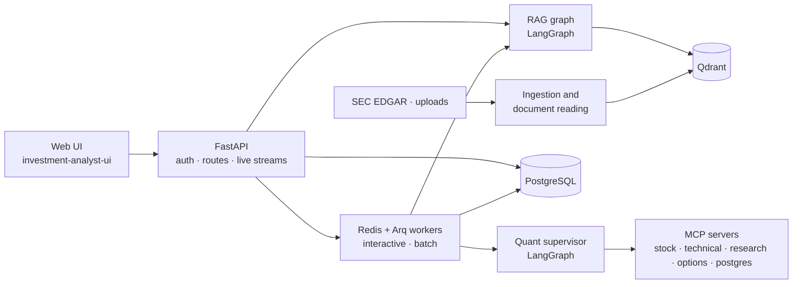

<div align="center">

# Investment Analyst

**AI research for investment teams. Ask questions of SEC filings and your own documents, run live quant analysis, and keep every answer traceable to its source.**


</div>

---

## Contents

[Overview](#overview) ·
[Features](#features) ·
[Architecture](#architecture) ·
[Quick start](#quick-start) ·
[Adding or updating a library](#adding-or-updating-a-library) ·
[Configuration](#configuration) ·
[Running in production](#running-in-production) ·
[Testing](#testing) ·
[Project structure](#project-structure) ·
[Troubleshooting](#troubleshooting) ·
[Documentation](#documentation)

---

## Overview

Investment Analyst puts three systems behind one FastAPI backend:

| | |
|---|---|
| **Document-grounded research** | Answers drawn from SEC filings (10-K, 10-Q, 8-K, 20-F, 6-K) and from files your team uploads, using hybrid search, re-ranking and a check that figures in the answer match the evidence. |
| **A quant agent team** | A LangGraph supervisor routes each question to specialists for market data, technicals, ratings, options, your databases, your data providers and your own MCP tools. |
| **A review-first document pipeline** | Uploaded files are read, checked, held for a person to approve, and only then made searchable. |

The web UI is a separate repository, `investment-analyst-ui`; the quick start installs both.

---

## Features

### Research

| Feature | What you get |
|---|---|
| **RAG over SEC filings** | Filing-type-aware retrieval (a "latest quarter" question goes to 10-Qs, an "annual report" question searches 10-K and 20-F together), fiscal-calendar-aware periods, hybrid dense + BM25 search, and guardrails when a comparison spans mismatched fiscal calendars. |
| **ALPHA framework** | A five-part equity report per ticker: Alignment (insider activity), Liquidity, Performance, Horizon and Action. |
| **Scenario framework** | Bull, base and bear cases generated on the same retrieval pipeline. |
| **Macro framework** | FRED and BLS series (GDP, CPI, PCE, PPI, Fed Funds, the Treasury yield curve, unemployment and participation), refreshed daily. |
| **Insider trading advisory** | Form 4 filings scored by role and dollar value into a plain-language recommendation. |
| **Custom frameworks** | Users define their own repeatable way of analysing a company, and the router can pick it. |
| **Verified answers** | Figures and units in an answer are checked against its sources, and citations open the filing page or document they came from. |

### Quant agents

| Agent | What it does |
|---|---|
| Ticker finder | Turns company names into ticker symbols. |
| Stock information | Prices, history, news, statements, holders, recommendations and projections, from the Yahoo Finance MCP server. |
| Technical analysis | SMA, RSI, MACD, Bollinger bands, volume and support/resistance, with chart summaries. |
| Research | Web research, analyst ratings, sentiment and bull/base/bear scenarios. |
| Options intelligence | Deterministic chain analytics: put/call ratio, strike concentration, IV skew, unusual volume and long-dated positioning. |
| Postgres | Read-only queries against a PostgreSQL database you connect. |
| Documents | Searches your approved uploaded documents. |
| Data Sources | Quotes, prices, profiles, statements and news from Alpha Vantage, Polygon.io, Finnhub, Twelve Data, Financial Modeling Prep, or your own API. |
| Your Tools | Calls remote MCP servers you connect. Tools that change things stay blocked unless you allow actions. |

### Your own content

| Feature | What you get |
|---|---|
| **My documents** | Upload PDFs, scans, photos, Excel/CSV, Word, PowerPoint, HTML or text. Each file is read, checked with finance arithmetic, and **held until you approve it**. Only then is it indexed. |
| **Import from a source** | Pull files from SharePoint, Google Drive, OneDrive, S3, Azure Blob, SFTP or Confluence into My documents, with the same review and approval. |
| **Document library and inspector** | Every ingested filing and upload opens beside its extracted text, tables and page data. |
| **Analyst notes** | Typed or handwritten notes, searchable alongside filings. Private unless shared, and shared notes stay out of your analysis until you switch them on. |
| **Bring your own models** | OpenAI, Anthropic, Gemini, Ollama or any OpenAI-compatible server, with per-user encrypted keys. |
| **Settings** | One schema for every option (models, retrieval, answers, modules, prompts, documents, quant), layered: code defaults, your deployment's defaults (`config.yaml`), then admin, user, portfolio and per request. Lean, Balanced and Thorough presets, and a Custom state when you change something they don't use. |

### Platform

Portfolio-scoped chat history with AI summaries, an analyst report clipboard with PDF export, a searchable repository for published reports, usage tracking, and Redis/Arq job queues so long analyses never block a request.

---

## Architecture



| Process | What it does |
|---|---|
| **API** (`uvicorn app.main:app`) | HTTP routes, auth, uploads, document reading, settings. Hands chats and long analyses to the workers and relays their live progress to the browser. |
| **Interactive worker** (`python -m app.worker interactive`) | Chats and quick runs. Add more of these to serve more users at once. |
| **Batch worker** (`python -m app.worker batch`) | Multi-ticker ALPHA runs, kept apart so they never slow a chat. |
| **MCP servers** (`backend/quant/*_mcp`) | Market-data tools for the quant agents, on ports 8565–8568 and 8570. |
| **PostgreSQL · Redis · Qdrant** | Application data and agent checkpoints · job queues and live updates · vectors. |

How a request flows, the RAG graph, ingestion, the document pipeline, the quant agents, the data model, the full API reference and how to extend each part are in **[docs/ARCHITECTURE.md](docs/ARCHITECTURE.md)**.

---

## Quick start

### Prerequisites

| Requirement | Notes |
|---|---|
| **Git** and both repositories side by side | `Investment_Analyst` (this one) and `investment-analyst-ui`. |
| **Docker** with Docker Compose | Runs Postgres, Redis and Qdrant, or the whole stack. |
| **Python 3.11, 3.12 or 3.13** | For running the backend on your machine. Not needed for the all-Docker route. |
| **Node.js 20.19+** (22 LTS recommended) | For running the web UI on your machine. Not needed for the all-Docker route. |
| **Tesseract OCR** | Reads scans. `brew install tesseract` · `sudo apt install tesseract-ocr` · Windows: the UB-Mannheim installer, then set `TESSERACT_CMD`. Included in the Docker image. |
| **API keys** | **OpenAI** (required), **FRED** (macro data), **Google** (quant chart summaries). Optional: Tavily (web search), Anthropic, Gemini, Groq, Cohere, BLS, Cloudinary. |

Works the same on **Windows, macOS and Linux**. Every pinned package installs from a pre-built wheel on Windows x64, Linux (x86-64 and ARM) and Apple-silicon Macs, so no compiler is needed. On an Intel Mac, PyMuPDF builds from source (install Xcode's command-line tools first), or use Docker.

```bash
git clone https://github.com/Ganesh-K-Indium/Investment_Analyst.git
git clone <ui-repo-url> investment-analyst-ui        # next to Investment_Analyst
cd Investment_Analyst
cp .env.example .env                                 # then fill in the keys (see Configuration)
```

### Option A: everything in Docker

```bash
docker compose --profile ui up -d --build
```

| URL | What |
|---|---|
| http://localhost:3000 | Web UI. Create an account on the sign-in page. |
| http://localhost:8000/docs | API documentation |
| http://localhost:8000/health | Health of the API, database and Redis |

This starts Postgres, Redis, Qdrant, the API (with the five MCP servers inside it), both workers and the UI. Leave out `--profile ui` to run the backend only. Data lives in Docker volumes and `./data`, so `docker compose down` and `up` keep everything. To use Qdrant Cloud or other managed services from the containers, set `COMPOSE_QDRANT_URL` (and `COMPOSE_DATABASE_URL`, `COMPOSE_REDIS_URL`) in `.env`.

### Option B: develop on your machine

One tool, `scripts/dev.py`, does the same thing on every OS. It needs nothing but Python. On Windows write `py scripts\dev.py` (or `python`) instead of `python3 scripts/dev.py`.

```bash
python3 scripts/dev.py setup     # virtualenv, pinned dependencies, Chromium for filings, .env, and the web UI's packages
                                 # now fill in .env (at least OPENAI_API_KEY)
python3 scripts/dev.py start     # Postgres/Redis/Qdrant (Docker), the 5 MCP servers, both workers, the API and the UI
```

| URL | What |
|---|---|
| http://localhost:5173 | Web UI. Create an account on the sign-in page. |
| http://localhost:8000/docs | API documentation |

`start` prints the API's log in the terminal and writes the others to `data/logs/dev/`; **Ctrl+C stops everything**. Useful options: `--reload` (restart the API, workers and MCP servers when their Python code changes; the web UI always updates live), `--no-ui`, `--no-workers`, `--no-mcp`, `--no-services` (you run Postgres, Redis and Qdrant yourself). The services are published on 5433 (Postgres, so it never clashes with a local one), 6379 and 6333, which is what `.env.example` points at.

| Command | Does |
|---|---|
| `dev.py status` | What is running, plus the configuration check (values in force, problems) |
| `dev.py services up` / `down` | Only Postgres, Redis and Qdrant |
| `dev.py mcp` | Only the five MCP servers (run the API from your IDE's debugger meanwhile) |
| `dev.py install` | Install the pinned dependencies again, e.g. after a `git pull` changed them |
| `dev.py lock` | Re-pin dependencies after editing `backend/pyproject.toml` (see [Adding or updating a library](#adding-or-updating-a-library)) |
| `dev.py test` | Run the test suite; extra arguments go to pytest, e.g. `dev.py test -k config` |

<details>
<summary><b>Running each part by hand</b></summary>

From `backend/`, with the virtualenv activated (`source ../venv/bin/activate`, or `..\venv\Scripts\activate` on Windows):

```bash
python -m uvicorn app.main:app --reload --port 8000    # API (migrates the database on startup)
python -m app.worker interactive                       # chats and quick runs
python -m app.worker batch                             # multi-ticker ALPHA runs
python ../scripts/dev.py mcp                           # the five MCP servers
```

The web UI: `cd ../investment-analyst-ui && npm ci && cp .env.example .env && npm run dev`.

</details>

Without the workers, chats still work (the API runs them itself) but background runs wait in the queue. Without the MCP servers, the quant agents that need them are left out.

### Load some data

```bash
cd backend
python scripts/ingest_ticker.py AAPL                              # pick filings interactively
python scripts/ingest_ticker.py AAPL --form-types 10-Q --limit 8
```

The CLI lists filings with a period column (`FY2024`, `2025Q3`, using the company's own fiscal calendar); select by row (`3`), range (`1-4`), period (`FY2024`) or `all`. Filings can also be fetched from the UI (Data Sources), and users upload their own documents under My documents. For many PDFs at once, `python -m ingestion.batch_ingest --manifest <file>` is resumable and retries failures with `--retry-failed`.

<details>
<summary><b>Optional OCR engines</b></summary>

Tesseract is enough to start. For difficult scans an administrator can add an engine, then restart the API:

| Engine | Install | Size |
|---|---|---|
| RapidOCR | `pip install rapidocr-onnxruntime` | ~100 MB, models included |
| PaddleOCR | `pip install paddlepaddle paddleocr` | ~430 MB + ~130 MB models |
| docTR | `pip install "python-doctr[torch]"` | ~630 MB + ~125 MB models |

Then **Settings → Your documents → Reading engines** downloads models, tests an engine on a sample page and selects it. From a terminal: `python -m app.docproc.engines.warmup --status` and `python -m app.docproc.engines.warmup`. Packages are deliberately not installed from the web UI.

</details>

---

## Adding or updating a library

Dependencies are declared once, in **`backend/pyproject.toml`** (version ranges). `backend/requirements.txt` is generated from it with the exact version of every package for Python 3.11–3.13 on Linux, macOS and Windows, so every developer, the Docker image and the server install the same thing.

```bash
# 1. add the library to the dependencies list in backend/pyproject.toml, e.g.  "humanize>=4.0",
python3 scripts/dev.py lock       # 2. re-pin: only the new library (and anything it needs) is added; nothing else moves
python3 scripts/dev.py install    # 3. install it
# 4. commit pyproject.toml, uv.lock and requirements.txt together
```

| To | Run |
|---|---|
| Upgrade one library | `dev.py lock --upgrade-package <name>`, then `dev.py install` |
| Upgrade everything within the allowed ranges | `dev.py lock --upgrade`, then `dev.py install` and `dev.py test` |
| Remove a library | delete it from `pyproject.toml`, then `dev.py lock` |

Never edit `requirements.txt` or `uv.lock` by hand. `lock` installs the resolver it needs (`uv`) into the virtualenv by itself. Docker builds use the same `requirements.txt`.

---

## Configuration

Settings come from four places. The first one that sets a value wins:

```
environment variables  >  .env  >  config.yaml  >  built-in defaults
```

| File | Put here |
|---|---|
| **`.env`** (from `.env.example`) | Secrets and connection strings: database, Redis, Qdrant, model and data keys, the four production secrets. |
| **`config.yaml`** (from `config.example.yaml`, optional) | Everything else you want to change: pools, worker limits, document reading, MCP server locations, and the **defaults users start from** in the Settings screen (`settings_defaults:`). |
| **Settings screen** (in the app) | What each admin, user and portfolio chooses: models per job, retrieval, answers, modules, prompts, documents, quant, appearance. |

Every setting has one name that works as an environment variable and as a `config.yaml` key; `config.example.yaml` lists them all with their defaults. Product settings resolve as *code defaults → deployment defaults (config.yaml / `SETTINGS__<SECTION>__<KEY>` variables) → admin → user → portfolio → per request*.

```bash
cd backend
python -m app.core.config        # every setting, its value (secrets masked), where it came from, and any problems
```

**The essentials**

| Variable | Purpose |
|---|---|
| `OPENAI_API_KEY` | Embeddings for all search, filing captions, and the default models. Users can bring other providers for chat, but search needs this key. |
| `DATABASE_URL`, `REDIS_URL`, `QDRANT_URL` (+ `QDRANT_API_KEY`) | The three services. |
| `FRED_API_KEY`, `GOOGLE_API_KEY` | Macro data; quant chart summaries. |
| `SEC_USER_AGENT` | Your company name and contact email, sent to SEC EDGAR as SEC requires. |
| `JWT_SECRET_KEY`, `APP_SECRET_KEY`, `INTEGRATION_SECRET_KEY`, `MCP_SHARED_SECRET` | Login tokens, saved provider keys, connector credentials, the Postgres tool's per-user token. Required in production; generate with `python -c "import secrets; print(secrets.token_hex(32))"`. |
| `CORS_ALLOWED_ORIGINS` | The web UI's address(es). |
| `APP_ENV` | `production` turns on the startup checks below. |

---

## Running in production

1. **Secrets and safety.** Set `APP_ENV=production`, the four secrets above, `CORS_ALLOWED_ORIGINS` to the UI's address and `CORS_ALLOWED_ORIGIN_REGEX=` (empty). The API and workers refuse to start until these are in place. On a shared server also set `LLM_ALLOW_PRIVATE_URLS=0` and keep `MCP_ALLOW_PRIVATE_URLS=0`.
2. **Start.** `docker compose --profile ui up -d --build`. Build the UI with `VITE_API_BASE_URL` set to the address browsers use for the API. Every service restarts automatically after a reboot.
3. **Scale.** One API process and more interactive workers: `docker compose up -d --scale worker-interactive=2`. Defaults suit about 50 active users on **8 vCPU / 32 GB**; 4 vCPU / 16 GB is enough for around 10. Above that, your model provider's rate limits are usually the ceiling.
4. **Data.** Back up Postgres (`pg_dump`) and the `data/` folder (filings, uploads, keys). Qdrant can be rebuilt by re-ingesting, or snapshotted.
5. **Health.** `GET /health` reports the database and Redis; `GET /quant/health` reports the MCP servers.

Hosting on an internal virtual machine is covered in [docs/VM_Hosting_Proposal.pdf](docs/VM_Hosting_Proposal.pdf).

---

## Testing

```bash
python3 scripts/dev.py test              # or, from backend/: pytest. About 2 minutes; needs no running Postgres, Redis or Qdrant
cd backend
python scripts/extraction_eval.py        # finance extraction accuracy on sample statements (local OCR, no model calls)
EVAL_TOKEN=… EVAL_THREAD_ID=… python scripts/rag_eval.py    # question set against a running API (uses models)
```

How the suite is organised and how to add a test: [backend/tests/README.md](backend/tests/README.md).

---

## Project structure

```
Investment_Analyst/
├── backend/                 All Python code. Run backend commands from here.
│   ├── app/                 FastAPI app
│   │   ├── main.py          App factory, startup and shutdown, /health
│   │   ├── worker.py        Background worker settings
│   │   ├── core/            config.py (all deployment settings), paths, logging, middleware, concurrency
│   │   ├── api/             One router per resource
│   │   ├── services/        Business logic (settings, providers, documents, chat, connectors, MCP)
│   │   ├── jobs/            Job queue, background jobs, chat streaming through the workers
│   │   ├── docproc/         Document-reading engine: OCR, layout, tables, figures, finance checks
│   │   └── auth/  database/  utils/
│   ├── rag/                 LangGraph RAG pipeline, vector store client, re-ranking, prompts
│   ├── quant/               Quant supervisor and agents, five MCP servers
│   ├── ingestion/           SEC filings, images, EDGAR, Form 4, macro data
│   ├── alembic/             Database migrations
│   ├── scripts/             Ingestion CLI, evaluations, developer tools
│   ├── tests/               pytest suite
│   ├── docker/              Container entrypoints
│   ├── pyproject.toml       Direct dependencies (edit this) and supported Python versions
│   ├── uv.lock              Resolved dependency graph (generated)
│   └── requirements.txt     Exact versions for every OS (generated; what pip and Docker install)
├── docs/                    Architecture guide and reference documents
├── scripts/                 dev.py: setup, start, test, lock on any OS (start_api / start_mcp_servers wrap it)
├── data/                    Runtime files (git-ignored)
├── docker-compose.yml
├── .env.example             Secrets and connection strings
└── config.example.yaml      Every other setting, with defaults (generated from backend/app/core/config.py)
```

---

## Troubleshooting

| Symptom | Likely cause and fix |
|---|---|
| The API refuses to start with a configuration error | Read the message: a production secret is missing, or a value in `config.yaml` / a `SETTINGS__` variable is misspelled or invalid. `python -m app.core.config` shows what is in force. |
| Background runs stay queued | The workers are not running. `dev.py start` runs them; check `dev.py status` and `data/logs/dev/worker-*.log`. |
| `dev.py setup` says the Python version is wrong | Run it with Python 3.11–3.13: `py -3.12 scripts\dev.py setup` (Windows), `python3.12 scripts/dev.py setup` (macOS/Linux). |
| A process stops right after `dev.py start` | Its log in `data/logs/dev/` says why; usually a missing key in `.env` or a service that is not running. |
| Installing dependencies tries to compile something | You are on an Intel Mac (PyMuPDF has no wheel there) or an unsupported Python. Use Python 3.11–3.13, install Xcode's command-line tools, or use Docker. |
| Everyone is signed out on each restart | `JWT_SECRET_KEY` is unset, so a new key is generated per start. Set it in `.env`. |
| Saved provider keys stop working | `APP_SECRET_KEY` changed. Users re-enter their keys. |
| A quant answer says an agent is unavailable | Its MCP server is not running. `dev.py status`, the `mcp-*.log` files in `data/logs/dev/`, and `/quant/health`. |
| The API in Docker cannot reach the database | `COMPOSE_DATABASE_URL` points somewhere unreachable; leave it unset to use the compose Postgres. |
| Scans are not read | Tesseract is missing. Install it, or set `TESSERACT_CMD`. |
| Table extraction tests fail | PyMuPDF 1.x is installed. `pip install "pymupdf>=2.1"`. |
| The UI build fails in Docker or locally | Node is older than 20.19. Use Node 22. |
| Database errors after switching branches | The database is migrated past this branch's revision. Use a separate database (`COMPOSE_PROJECT_NAME`) or `alembic downgrade`. |
| Charts have no hosted image | Cloudinary is not configured; charts are still generated. |

---

## Documentation

| Document | Covers |
|---|---|
| [docs/ARCHITECTURE.md](docs/ARCHITECTURE.md) | Code layout and rules, configuration, request and chat flows, RAG, ingestion, documents, quant, concurrency, data model, API reference, how to extend, known limitations |
| [config.example.yaml](config.example.yaml) | Every deployment setting with its default and meaning |
| [backend/tests/README.md](backend/tests/README.md) | The test suite and how to add tests |
| [scripts/README.md](scripts/README.md) | The developer tool (`dev.py`) and launch scripts |
| [docs/options_mcp/](docs/options_mcp/) | The options intelligence agent and the raw data it works from |
| [docs/RAG_TEST_QUESTIONS.md](docs/RAG_TEST_QUESTIONS.md) | Manual question checklist for the research agent |
| [docs/VM_Hosting_Proposal.pdf](docs/VM_Hosting_Proposal.pdf) | Hosting on an internal virtual machine |

---

<div align="center">

**Built with** FastAPI · LangGraph · LangChain · Qdrant · PostgreSQL · Redis and Arq · FastMCP · Playwright · Tesseract · OpenAI · Google Gemini

</div>
