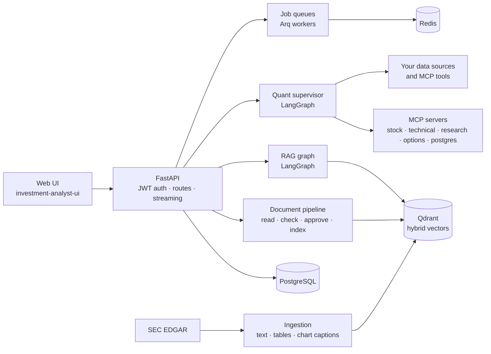

<div align="center">

# Investment Analyst

**AI research for investment teams. Ask questions of SEC filings and your own documents, run live quant analysis, and keep every answer traceable to its source.**


</div>

---

## Contents

[Overview](#overview) ·
[Features](#features) ·
[Architecture](#architecture) ·
[How it works](#how-it-works) ·
[Quick start](#quick-start) ·
[Configuration](#configuration) ·
[API reference](#api-reference) ·
[Data model](#data-model) ·
[Deployment](#deployment) ·
[Testing](#testing) ·
[Project structure](#project-structure) ·
[Troubleshooting](#troubleshooting) ·
[Known limitations](#known-limitations)

---

## Overview

Investment Analyst puts three systems behind one FastAPI backend:

| | |
|---|---|
| **Document-grounded research** | Answers drawn from SEC filings (10-K, 10-Q, 8-K, 20-F, 6-K) and from files your team uploads, using hybrid search, re-ranking and a check that figures in the answer match the evidence. |
| **A quant agent team** | A LangGraph supervisor routes each question to specialists for market data, technicals, ratings, options, your databases, your data providers and your own MCP tools. |
| **A review-first document pipeline** | Uploaded files are read, checked, held for a person to approve, and only then made searchable. |

The web UI is a separate repository, `investment-analyst-ui`.

---

## Features

### Research

| Feature | What you get |
|---|---|
| **RAG over SEC filings** | Filing-type-aware retrieval (a "latest quarter" question goes to 10-Qs, an "annual report" question searches 10-K and 20-F together), fiscal-calendar-aware periods, hybrid dense + BM25 search, and guardrails when a comparison spans mismatched fiscal calendars. |
| **ALPHA framework** | A five-part equity report per ticker: Alignment (insider activity), Liquidity, Performance, Horizon and Action. |
| **Scenario framework** | Bull, base and bear cases generated on the same retrieval pipeline. |
| **Macro framework** | FRED and BLS series (GDP, CPI, PCE, PPI, Fed Funds, the Treasury yield curve, unemployment and participation), refreshed daily. |
| **Insider trading advisory** | Form 4 filings scored by role and dollar value into a plain-language recommendation. |
| **Custom frameworks** | Users define their own repeatable way of analysing a company, and the router can pick it. |
| **Verified answers** | Figures and units in an answer are checked against its sources, and citations open the filing page or document they came from. |

### Quant agents

| Agent | What it does |
|---|---|
| Ticker finder | Turns company names into ticker symbols. |
| Stock information | Prices, history, news, statements, holders, recommendations and projections, from the Yahoo Finance MCP server. |
| Technical analysis | SMA, RSI, MACD, Bollinger bands, volume and support/resistance, with chart summaries. |
| Research | Web research, analyst ratings, sentiment and bull/base/bear scenarios. |
| Options intelligence | Deterministic chain analytics: put/call ratio, strike concentration, IV skew, unusual volume and long-dated positioning. |
| Postgres | Read-only queries against a PostgreSQL database you connect. |
| Documents | Searches your approved uploaded documents. |
| Data Sources | Quotes, prices, profiles, statements and news from Alpha Vantage, Polygon.io, Finnhub, Twelve Data, Financial Modeling Prep, or your own API. |
| Your Tools | Calls remote MCP servers you connect. Tools that change things stay blocked unless you allow actions. |

### Your own content

| Feature | What you get |
|---|---|
| **My documents** | Upload PDFs, scans, photos, Excel/CSV, Word, PowerPoint, HTML or text. Each file is read, checked with finance arithmetic, and **held until you approve it**. Only then is it indexed. |
| **Import from a source** | Pull files from SharePoint, Google Drive, OneDrive, S3, Azure Blob, SFTP or Confluence into My documents, with the same review and approval. |
| **Document library and inspector** | Every ingested filing and upload opens beside its extracted text, tables and page data. |
| **Analyst notes** | Typed or handwritten notes, searchable alongside filings. Private unless shared, and shared notes stay out of your analysis until you switch them on. |
| **Bring your own models** | OpenAI, Anthropic, Gemini, Ollama or any OpenAI-compatible server, with per-user encrypted keys. |
| **Settings** | One schema for every option (models, retrieval, answers, modules, prompts, documents, quant), layered defaults, then admin, user, portfolio and per request. Lean, Balanced and Thorough presets, and a Custom state when you change something they don't use. |

### Platform

Portfolio-scoped chat history with AI summaries, an analyst report clipboard with PDF export, a searchable repository for published reports, usage tracking, and Redis/Arq job queues so long analyses never block a request.

---

## Architecture



### Services and storage

| Component | Role |
|---|---|
| **FastAPI** | One app, per-route JWT auth, request logging, CORS, server-sent events for streaming. |
| **PostgreSQL** | All application data (async SQLAlchemy, Alembic migrations) and the LangGraph checkpointer. |
| **Qdrant** | One hybrid collection per ticker (`ticker_{ticker}`) for filings, plus `user_documents` and `analyst_notes`. Dense (OpenAI `text-embedding-3-large`, 3072 dimensions) and BM25 vectors are fused with reciprocal rank fusion. |
| **Redis + Arq** | Background job queues and the pub/sub channel behind task streaming. |
| **MCP servers** | Five FastMCP processes the quant agents call over streamable HTTP. |
| **Data directory** | `data/` holds filings, uploads, keys, caches and logs. Move it with `DATA_DIR`. |

RAG and quant share one Postgres-backed checkpointer. Every checkpoint key is prefixed (`rag:` or `quant:`), so the two can never collide even if a session id were reused.

---

## How it works

### Answering a question

`route_query` picks a branch: ALPHA, Scenario, Macro, one of the user's own frameworks, or standard. The standard branch runs:

```
clarify (optional pause) → preprocess → retrieve → grade_documents
        │                                     │            │
        │                                     │            ├─ enough evidence ─────────────→ generate
        │                                     │            └─ not enough → rewrite_query → retrieve (corrective retry)
        │                                     │                          └→ integrate_web_search → generate
        └─ web_search (when the question needs no filings) ───────────────────────────────────→ generate

generate → verify_answer → generate_chart (optional) → show_result
```

- **Preprocess** resolves tickers, filing types, fiscal quarters and years, and builds sub-queries. Comparison, segment and geographic questions use ready-made templates with no extra model call.
- **Retrieve** runs hybrid search per ticker, then a cross-encoder re-rank, and adds the user's notes and approved documents. A quarter or filing type you ask for gets its own search pass so a higher-scoring one cannot crowd it out.
- **Fiscal calendars.** Apple's fiscal Q1 is not a calendar-year filer's Q1. A table of fiscal year-end months maps periods correctly, and a comparison across mismatched calendars carries a warning into the answer.
- **Verify** checks figures and units in the answer against the retrieved evidence.

### Ingesting SEC filings

Filings come from EDGAR (fetched over HTTP, then rendered to PDF locally with Playwright) or from files you provide. Each filing resolves three fields in a fixed order, and never guesses silently:

| Field | Resolution order |
|---|---|
| `filing_type` | Explicit value, then the cover page, then the filename, then `10-K` as a last resort with a loud warning. |
| `period_end_date` | Explicit value (EDGAR's `reportDate`), then the cover page, otherwise left unset. |
| `fiscal_quarter` | Derived from the period end and the company's fiscal calendar, for 10-Qs only. |

Then, per filing:

1. **Text.** PyMuPDF reads each page. Financial tables are rebuilt from word positions (columns from the numbers' right edges, row labels and wrapped labels kept, multi-row headers flattened), with a completeness guard that falls back to ruling-line extraction if any printed number would be dropped.
2. **Chunks.** Page text is split at 1,024 tokens with 300 overlap. Tables are packed whole into separate `[TABLES]` chunks (`chunk_kind: table`) and never cut mid-row. Each chunk is embedded with a context header (company, filing, period, section, page), while the stored text stays clean.
3. **Images.** Embedded charts and images are filtered for decoration, read with Tesseract, then captioned by a vision model that also sees the surrounding text and the OCR output. Refusals are discarded.
4. **Duplicates.** Documents and images are deduplicated by content hash, so a repeated logo does not hide the real charts in the same filing.

One shared method embeds and stores chunks for filings, user documents and notes, in small batches with retries if Qdrant drops a connection.

### Your documents

```
upload or import → read → check → HOLD for your approval → index → searchable
```

- **Formats.** PDFs, scans and photos (images are wrapped into a PDF first), Excel/CSV, Word, PowerPoint, HTML and text. Native formats are read directly and exactly, with no OCR.
- **Reading.** Digital pages are read by code. Scans go through local OCR first, with a vision model only where it is doubtful. Reading strategy is economy, balanced or accuracy.
- **Checks.** Finance arithmetic (totals, subtotals, units and currency) flags doubtful figures for a person to confirm.
- **Approval.** Nothing is indexed until you approve it. After approval, your index policy still applies: `after_review` indexes pages once confirmed, `flagged` indexes now and marks low confidence, `never` keeps it out of search.
- **Sharing.** Documents are private by default. A document shared with the workspace is searchable by everyone on the deployment.
- **OCR engines.** Tesseract is the default. RapidOCR, PaddleOCR and docTR are optional, installed by an administrator (see Quick start).

### The quant system

A LangGraph supervisor (`langgraph_supervisor`) routes each question to the agents that came up. Four agents depend on their own MCP server and are only created when it is reachable. The ticker finder, Postgres, documents, Your Tools and Data Sources agents are created without waiting for one.

| MCP server | Port | Folder |
|---|---|---|
| Stock information | 8565 | `backend/quant/yahoo_mcp` |
| Technical analysis | 8566 | `backend/quant/technical_mcp` |
| Research and ratings | 8567 | `backend/quant/research_mcp` |
| Options intelligence | 8568 | `backend/quant/options_mcp` |
| Postgres query | 8570 | `backend/quant/postgres_mcp` |

- **Options analytics are code, not model guesses.** The model only turns pre-computed numbers into prose. Chains come from Yahoo Finance (about 15 minutes delayed) across up to six expirations.
- **Your data sources.** Keys are tested when you connect a source, stored encrypted, and used only on the server. Results are quoted so the model treats them as data, trimmed to the newest rows and capped in size.
- **Your MCP servers.** Remote servers only. Tools that are not read-only stay blocked until you allow actions for that server, and a state-changing call needs explicit confirmation. Addresses on this machine or a private network are refused unless `MCP_ALLOW_PRIVATE_URLS=1`, and cloud-metadata addresses are always refused.
- **Postgres.** Queries run in a read-only transaction with a statement timeout.

### Background jobs

`/ask`, `/compare`, `/alpha` and `/quant/query` run synchronously. Each has a queued equivalent under `/analysis-tasks` that returns a task id immediately, so long runs do not hold an HTTP request open.

| Route | Queue |
|---|---|
| `POST /analysis-tasks/rag/ask` | interactive (up to 20 jobs at once) |
| `POST /analysis-tasks/rag/compare` | interactive |
| `POST /analysis-tasks/quant/query` | interactive |
| `POST /analysis-tasks/rag/alpha` | batch (up to 5 jobs at once) |

Queued and direct calls share one code path. Progress is stored on an `analysis_tasks` row and published over Redis, and you can poll a task or stream updates per portfolio or per user. Every enqueue route accepts `scheduled_at` to defer a run. Both worker types run the same functions and each builds its own copy of the RAG graph and quant supervisor.

### Insider trading and macro data

**Form 4.** Filings are fetched from EDGAR, parsed, limited to common-stock transactions, and deduplicated by accession number. Amendments (4/A) replace the earlier rows. The advisory score weights each transaction by role (officer ×2, director ×1.5, 10% owner ×1.2) and by dollar value, with purchases and sales scored in opposite directions, and a model turns the result into a recommendation. Foreign private issuers file no Form 4 and are skipped with a message.

**Macro.** Eighteen FRED series (GDP quarterly and annual, CPI, PCE, PPI, ECI, Fed Funds, and Treasury yields from one month to thirty years) plus BLS series including the unemployment rate and labor force participation. Each series is written atomically to `data/macro/`. The API ingests on startup if the data is missing, then re-syncs every 24 hours, and a file lock prevents concurrent runs.

### Settings and providers

Every option lives in one schema with the sections `models`, `retrieval`, `answers`, `modules`, `prompts`, `documents` and `quant`, resolved in layers: defaults, admin, user, portfolio, then per request. Every model call goes through one role-based lookup, so changing a model is a setting rather than a code change. Users add providers under **Settings → AI providers**, and keys are encrypted at rest.

---

## Quick start

### Prerequisites

| Requirement | Notes |
|---|---|
| Python 3.11+ | |
| Docker | For Postgres, Qdrant and Redis. Your own instances work too. |
| Tesseract OCR | The default engine for scans. `brew install tesseract` · `sudo apt install tesseract-ocr` · Windows: UB-Mannheim installer, then set `TESSERACT_CMD`. The Docker image includes it. |
| Node 18+ | For the web UI. |
| API keys | OpenAI (required), Google (required, Gemini chart summaries), FRED (required for macro data). Tavily, Groq and BLS are optional. |

### 1. Install

```bash
git clone https://github.com/Ganesh-K-Indium/Investment_Analyst.git
cd Investment_Analyst

python -m venv venv
source venv/bin/activate                  # Windows: venv\Scripts\activate
pip install -r backend/requirements.txt
playwright install chromium               # renders EDGAR filings to PDF

cp .env.example .env                      # then fill in your keys
```

> The virtualenv stays at the repo root. The code lives in `backend/`, and everything the app writes at runtime goes to `data/` (override with `DATA_DIR`). Run the commands below from `backend/` unless noted.

### 2. Start the services

```bash
docker compose up -d postgres qdrant redis
```

Postgres is published on host port **5433** (to avoid clashing with a local Postgres), Qdrant on **6333** and Redis on **6379**.

### 3. Migrate the database

```bash
cd backend
alembic upgrade head
```

The schema is at revision `025_user_data_sources`. The API also migrates on startup.

### 4. Run the API and workers

```bash
# terminal 1 (from backend/)
python -m uvicorn app.main:app --reload --port 8000

# terminals 2 and 3: needed for background and batch analysis runs
arq app.worker.InteractiveWorkerSettings
arq app.worker.BatchWorkerSettings
```

Without the workers, jobs queue in Redis but never run. On startup the API builds the RAG graph, initialises the quant supervisor (it waits briefly for the MCP servers and carries on if some are down), connects to Redis, and starts the macro sync.

### 5. Start the quant MCP servers (optional)

```bash
./scripts/start_mcp_servers.sh start      # also: stop | status | logs
```

This starts all five servers from the table above and sets `PYTHONPATH` so they can import the app. By hand, run `python server.py` (stock information) or `python server_mcp.py` (the others) inside each `backend/quant/<server>/` folder.

### 6. Start the web UI

```bash
git clone <ui-repo-url> investment-analyst-ui && cd investment-analyst-ui
npm install
echo "VITE_API_BASE_URL=http://localhost:8000" > .env
npm run dev                               # http://localhost:5173
```

### 7. Ingest a few filings

```bash
cd backend
python scripts/ingest_ticker.py AAPL
python scripts/ingest_ticker.py AAPL --form-types 10-Q --limit 8
python scripts/ingest_ticker.py AAPL --all --no-ingest
```

The CLI lists available filings with a period column (`FY2024` for 10-Ks, `2025Q3` for 10-Qs, using the company's own fiscal calendar). Select by row number (`3`), range (`1-4`), period label (`FY2024`, `2025Q1`), or `all`, mixed freely and comma-separated. For many PDFs at once, `python -m ingestion.batch_ingest --manifest <file>` keeps a progress file, skips finished files on re-run, and retries only failures with `--retry-failed`.

### Or run everything in Docker

```bash
docker compose up --build
```

Starts Postgres, Qdrant, Redis, the API, both workers and four of the MCP servers. The Postgres MCP server is not started in the container, so start it by hand if you use a Postgres data source.

| URL | Purpose |
|---|---|
| http://localhost:8000/docs | Interactive API documentation |
| http://localhost:8000/health | Aggregated health check |

<details>
<summary><b>Install packages by hand, and optional OCR engines</b></summary>

`backend/requirements.txt` covers everything, including PyMuPDF **2.x** (PyMuPDF 1.x finds tables differently and the extraction tests fail). To install the newer pieces yourself:

```bash
pip install "pymupdf>=2.1" "pymupdf-layout>=2.1" openpyxl python-docx python-pptx beautifulsoup4 lxml \
            langchain-anthropic langchain-google-genai langchain-ollama arq fastembed
```

Tesseract is enough to start. Add an engine for better results on difficult scans, then restart the API.

| Engine | Install | Size |
|---|---|---|
| RapidOCR | `pip install rapidocr-onnxruntime` | ~100 MB, models included |
| PaddleOCR | `pip install paddlepaddle paddleocr` | ~430 MB + ~130 MB models |
| docTR | `pip install "python-doctr[torch]"` | ~630 MB + ~125 MB models |

An administrator then opens **Settings → Your documents → Reading engines** to download models, test an engine on a sample page and choose it. From a terminal, `python -m app.docproc.engines.warmup --status` shows what is on disk and `python -m app.docproc.engines.warmup` downloads models. Installing packages is deliberately not offered from the web UI, because a web request should not change the server's own software.

</details>

<details>
<summary><b>Switching branches, CORS, and running outside Docker</b></summary>

- **Older branches.** A branch cannot start on a database already migrated past its own newest revision. Keep a separate database per branch, or run `alembic downgrade <revision>` first. This branch's compose project is named `investment_analyst_new` (override with `COMPOSE_PROJECT_NAME`), so its Postgres and Redis volumes are separate.
- **CORS.** `localhost` and `127.0.0.1` on any port are allowed by default. In production set `CORS_ALLOWED_ORIGIN_REGEX=` (empty) and list origins in `CORS_ALLOWED_ORIGINS`.
- **Outside Docker**, point `DATABASE_URL` and `REDIS_URL` at `localhost`. Inside Docker the containers reach each other by service name.

</details>

---

## Configuration

Copy `.env.example` to `.env`. These are the settings that matter most. The example file lists the rest.

<details open>
<summary><b>Required</b></summary>

| Variable | Purpose |
|---|---|
| `OPENAI_API_KEY` | Embeddings (shared by every user's search), filing captions, handwritten notes and the default chat models. Users can bring other providers for chat, but search still needs this key. |
| `QDRANT_URL`, `QDRANT_API_KEY` | Vector database, Qdrant Cloud or self-hosted. |
| `DATABASE_URL` | Postgres connection string. |
| `REDIS_URL` | Background job queue. |
| `GOOGLE_API_KEY` | Gemini vision for quant chart summaries. |
| `FRED_API_KEY` | Macro data. |
| `POSTGRES_USER`, `POSTGRES_PASSWORD`, `POSTGRES_DB` | Initial role and database for the compose Postgres. |

</details>

<details>
<summary><b>Security and production</b></summary>

| Variable | Purpose |
|---|---|
| `JWT_SECRET_KEY` | Signs auth tokens. **Required in production** (the app refuses to start without it). In development a random secret is used, so every restart signs everyone out. |
| `APP_SECRET_KEY` | Encrypts the provider keys users save. Recommended, and required for shared deployments. Changing it makes saved keys unreadable. |
| `INTEGRATION_SECRET_KEY` | Encrypts stored connector credentials. Required for file and database integrations. |
| `MCP_SHARED_SECRET` | Signs the per-request token the Postgres MCP tool verifies, so a model cannot query another user's database. Required in production. |
| `LOCAL_ONLY` | `1` keeps everything on the machine: cloud models and model downloads are off. |
| `LOCK_SETTINGS` | `1` makes the provider screen read-only. |
| `LLM_ALLOW_PRIVATE_URLS`, `MCP_ALLOW_PRIVATE_URLS` | `0` refuses localhost and private-network addresses (set this on a shared server). Cloud-metadata addresses are always refused. |
| `CORS_ALLOWED_ORIGINS`, `CORS_ALLOWED_ORIGIN_REGEX` | Allowed frontend origins. |
| `ACCESS_TOKEN_EXPIRE_MINUTES`, `REFRESH_TOKEN_EXPIRE_DAYS` | Token lifetimes (default 30 minutes and 7 days). |
| `APP_ENV`, `LOG_LEVEL` | General app configuration. |

Generate a secret with `python -c "import secrets; print(secrets.token_hex(32))"`.

</details>

<details>
<summary><b>Optional</b></summary>

| Variable | Purpose |
|---|---|
| `ANTHROPIC_API_KEY`, `GEMINI_API_KEY`, `OLLAMA_BASE_URL`, `LLM_CUSTOM_BASE_URL`, `LLM_CUSTOM_API_KEY`, `OPENAI_BASE_URL` | Server-wide fallback model providers, for anyone who saves no key of their own. |
| `GROQ_API_KEY`, `TAVILY_API_KEY`, `BLS_API_KEY` | Alternative LLM, web search, and extra macro series. |
| `COHERE_API_KEY`, `RERANK_LOCAL_MODEL` | Re-ranker. A local cross-encoder is the default (about 90 MB, downloaded on first use). |
| `SEC_USER_AGENT` | Sent on every EDGAR request. **Set this to your own contact details.** |
| `DATA_DIR`, `DOCPROC_DATA_DIR` | Where runtime files live (default `data/`, and `data/docproc` for OCR models and keys). |
| `MAX_UPLOAD_MB`, `MAX_PAGES` | Default upload and page limits for documents (50 MB and 200 pages). Users can change them in Settings. |
| `TESSERACT_CMD` | Path to the Tesseract binary, for Docker and ECS. |
| `USE_HYBRID_SEARCH` | Dense + BM25 versus dense only at ingestion (default on). |
| `CONTEXTUAL_PREFIX` | `0` turns off the company, filing, period and section header added to each chunk's embedding text (default on). |
| `MCP_<NAME>_URL`, `_ENABLED`, `_BIND`, `MCP_HOST` | Where each quant MCP server lives. |
| `CLOUDINARY_CLOUD_NAME`, `CLOUDINARY_API_KEY`, `CLOUDINARY_API_SECRET` | Chart image hosting. Charts degrade gracefully without it. |
| `SAVE_DEBUG_RESPONSES` | Dumps full response payloads to `data/output/json/` for debugging (default off). |

</details>

---

## API reference

Interactive documentation is served at `/docs`. Almost every route requires a JWT. The public ones are signup, login, token refresh, and the `/health` and `/capabilities` routes of the RAG and quant routers, plus the root `/` and `/health`. A request for another user's resource returns 404 rather than 403, so existence is not leaked.

| Area | Prefix | Main routes |
|---|---|---|
| **Auth** | `/auth` | `POST /signup`, `/login`, `/refresh`, `/logout` · `GET`/`PUT /me` |
| **RAG** | none | `POST /ask`, `/ask/stream`, `/compare`, `/alpha` · `GET /health`, `/capabilities`, `/sessions/{id}`, `/portfolio/{id}/sessions` |
| **Quant** | `/quant` | `POST /query`, `/query/stream` · `GET /health`, `/capabilities`, `/sessions/{id}`, `/portfolio/{id}/sessions` |
| **Background tasks** | `/analysis-tasks` | `POST /rag/ask`, `/rag/compare`, `/rag/alpha`, `/quant/query` · `GET /`, `/{task_id}`, `/stream/{portfolio_id}`, `/stream/user/{user_id}` |
| **Portfolios** | `/portfolios` | CRUD, `GET /user/{user_id}`, `GET /dashboard/cross-portfolio`, `POST`/`GET /sessions` |
| **Chats** | `/chats` | Sessions, messages, export, stats, per-session and consolidated summaries |
| **Reports** | `/reports` | Draft clipboard (`/draft/items`), `POST /from-draft/{user_id}`, CRUD, `/search`, `/repository/stats`, publish and unpublish, `GET /{id}/export/pdf` |
| **SEC filings** | `/edgar` | `POST /ingest` (fetch, render and ingest), filing PDF download |
| **Form 4** | `/form4` | `POST /ingest`, `/ingest/batch`, `/ingest/stream` (server-sent events) |
| **Filing library** | `/documents` | List and facets, `POST /sync`, one document, pages, `/pages/{n}/locate`, `/pdf`, `/ensure-pdf`, `/pdf-status` |
| **My documents** | `/user-documents` | `POST` (upload), `POST /import`, list, `GET`/`PATCH`/`DELETE /{id}`, `/reread`, `/review`, `/approve`, `/content`, `/file`, `/pdf`, `GET /types` |
| **Reading engines** | `/reading` | `GET /engines`, `POST /engines/{id}/prepare`, `POST /engines/test` |
| **Notes** | `/notes` | `POST /transcribe`, CRUD, `PUT /{id}/inclusion` |
| **Settings** | `/settings` | User, portfolio and system settings, `/schema`, `/prompts`, `/usage`, `/frameworks/template` |
| **AI providers** | `/providers` | List, save and remove keys, `POST /{id}/test`, `GET /{id}/models` |
| **Data sources** | `/data-sources` | Market data providers: list, add (tested first), update, remove, `POST /{id}/test` |
| **Your MCP servers** | `/mcp-servers` | List, add (tested first), update, remove, `POST /{id}/test` |
| **File and database sources** | `/integrations` | CRUD, `/disconnect`, `/test`, `POST /browse` |

---

## Data model

| Table | Purpose |
|---|---|
| `users` | Accounts with a role (analyst, fund manager or admin) and a token version for real logout. |
| `portfolios`, `sessions` | Named ticker collections and their conversation sessions. |
| `chat_sessions`, `chat_messages`, `consolidated_summaries` | Conversation history for RAG and quant, with cached AI summaries. |
| `analyst_reports`, `report_draft_items` | Published and draft reports (Postgres full-text search), and the server-side clipboard. |
| `integrations` | File and database source connections, credentials encrypted. |
| `documents` | A cache of what is in Qdrant, behind the filing library. |
| `user_documents` | Uploaded files: status, approval, review state, extraction stats. |
| `analyst_notes`, `analyst_note_inclusions` | Notes and who has switched them into their analysis. |
| `settings`, `usage_events` | Layered settings records, and per-call token and cost tracking. |
| `provider_credentials` | Per-user encrypted model provider keys. |
| `user_mcp_servers`, `user_data_sources` | Your MCP servers and market data providers, credentials encrypted. |
| `form4_transactions` | Insider transactions, indexed by issuer and date. |
| `analysis_tasks` | Status and results of background runs. |

Migrations are a single linear chain managed by Alembic, currently at `025_user_data_sources`.

---

## Deployment

### Docker Compose

| Service | Image | Notes |
|---|---|---|
| `postgres` | `postgres:16-alpine` | Host port 5433, health-checked. |
| `qdrant` | `qdrant/qdrant` | Ports 6333 (REST) and 6334 (gRPC). |
| `redis` | `redis:7-alpine` | Port 6379, health-checked. |
| `api` | built from `backend/Dockerfile` | Port 8000 and the four core MCP ports (8565 to 8568). Mounts `./data` at `/app/data`. |
| `worker-interactive`, `worker-batch` | same image | Arq workers. They share the API container's network so their calls to the MCP servers on `localhost` reach them. |

The API entrypoint starts the four MCP servers, waits a few seconds, runs `alembic upgrade head`, then starts uvicorn. The image is Python 3.11 with Chromium (EDGAR rendering) and Tesseract. It sets `DATA_DIR=/app/data` and `PYTHONPATH=/app`.

For production, set `APP_ENV=production` and provide `JWT_SECRET_KEY`, `APP_SECRET_KEY`, `INTEGRATION_SECRET_KEY` and `MCP_SHARED_SECRET`. Point `DATABASE_URL`, `QDRANT_URL` and `REDIS_URL` at managed services if you have them. Mount a persistent volume on `data/`, restrict `CORS_ALLOWED_ORIGINS`, and set the two `*_ALLOW_PRIVATE_URLS` variables to `0` on a shared server.

---

## Testing

Run from `backend/`.

```bash
pytest --ignore=tests/test_api_v2.py     # about 2.5 minutes; the extraction tests run OCR
python scripts/extraction_eval.py        # finance extraction accuracy, local OCR, no LLM calls
EVAL_TOKEN=… EVAL_THREAD_ID=… python scripts/rag_eval.py    # question set against a running API
```

`tests/test_api_v2.py` needs a running Postgres. To measure RAG accuracy, fill in the `expected` answers in `tests/rag_eval/golden.jsonl`.

---

## Project structure

```
Investment_Analyst/
├── backend/                 All Python code. Run commands from here.
│   ├── app/                 FastAPI app
│   │   ├── api/             Routers
│   │   ├── services/        Business logic (settings, LLM providers, user documents, data sources, MCP)
│   │   ├── docproc/         Document-reading engine: OCR, layout, tables, finance checks
│   │   ├── auth/  database/  jobs/  core/paths.py  worker.py
│   ├── rag/                 LangGraph RAG pipeline, Qdrant client, prompts, re-ranking, verification
│   ├── ingestion/           PDF and image processing, EDGAR fetcher, Form 4 and macro pipelines
│   ├── quant/               Supervisor, sub-agents, five MCP servers
│   ├── schemas/             Pydantic models
│   ├── alembic/             Database migrations
│   ├── scripts/             Ingestion CLI, evaluation and developer tools
│   ├── tests/               pytest suite (tests/docproc covers the extraction engine)
│   ├── sample_data/         Sample PDFs for tests and demos
│   └── docker/              Container entrypoints
├── scripts/                 Launchers: start_api and start_mcp_servers (.sh and .bat)
├── data/                    Runtime files: filings, uploads, keys, caches, logs (git-ignored)
├── venv/                    Virtualenv (git-ignored, outside backend/)
└── docker-compose.yml  .env.example
```

---

## Troubleshooting

| Symptom | Likely cause and fix |
|---|---|
| Background runs stay queued | The Arq workers are not running. Start both (step 4). |
| Everyone is signed out on each restart | `JWT_SECRET_KEY` is unset, so a new secret is generated per start. Set it in `.env`. |
| Saved provider keys stop working | `APP_SECRET_KEY` changed. Users re-enter their keys. |
| A quant answer says an agent is unavailable | Its MCP server is not running. Start them with `./scripts/start_mcp_servers.sh start` and check `/quant/health`. |
| Scans are not read | Tesseract is missing. Install it, or set `TESSERACT_CMD`. |
| Table extraction tests fail | PyMuPDF 1.x is installed. Use `pymupdf>=2.1`. |
| Charts have no images | Cloudinary is not configured. Charts still generate. |
| Database errors after switching branches | The database is migrated past this branch's revision. Use a separate database or run `alembic downgrade`. |
| A "document not found" PDF in the inspector | The file was removed from `data/sec_filings/`. Use the re-download action to fetch it again. |

---

## Known limitations

- **Embeddings are shared.** Search uses one server OpenAI key for everyone, whatever chat provider a user picks, and changing the embedding model means re-indexing every collection.
- **Poor scans.** Vision models can invent plausible text on very bad scans. Doubtful pages are held for review by default (Settings → Your documents → "Index low-confidence text"), and `scripts/extraction_eval.py` shows measured behaviour on financial statements.
- **Verification scope.** Answers are checked for figures and units against their sources, not for claims or reasoning.
- **Per-route auth.** `Depends(get_current_user)` guards individual endpoints rather than a global middleware, because login, token refresh and a few health routes must stay public.
- **Postgres MCP server.** It is not part of the container's startup, and it is not in the supervisor's readiness wait or `/quant/health`. A question routed to it fails at call time if it is not running.
- **Confirmation for changing tools.** Calls to a connected MCP tool that changes things rely on the agent asking for confirmation, because the quant stream has no interrupt step.
- **Bloomberg and Refinitiv** have no open internet API. Reach them through your own gateway with the Custom API data source.
- **Migration history.** `alembic/versions/` has three differently named migrations that add similar chat summary fields. They are a genuine linear sequence, but worth checking before assuming a clean chain.

---

<div align="center">

**Built with** FastAPI · LangGraph · LangChain · Qdrant · PostgreSQL · Redis and Arq · FastMCP · Playwright · Tesseract and GPT-4o vision · Google Gemini · Cloudinary

</div>
