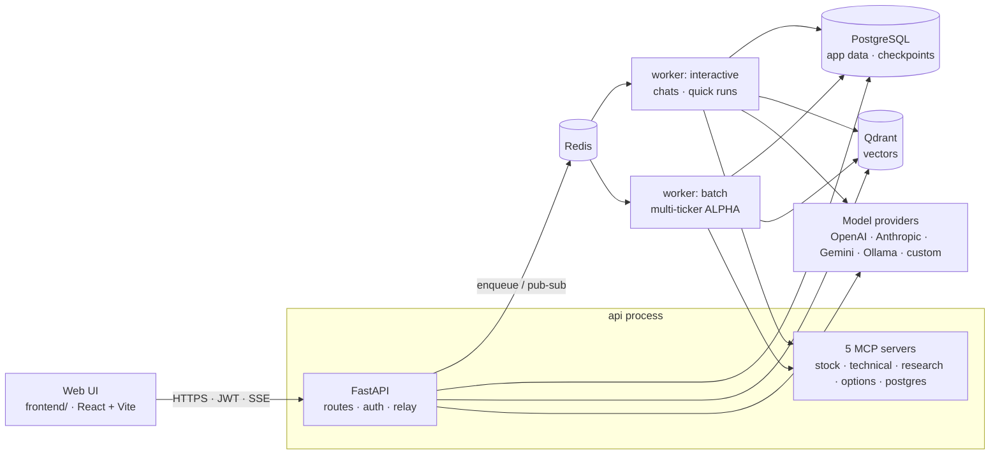
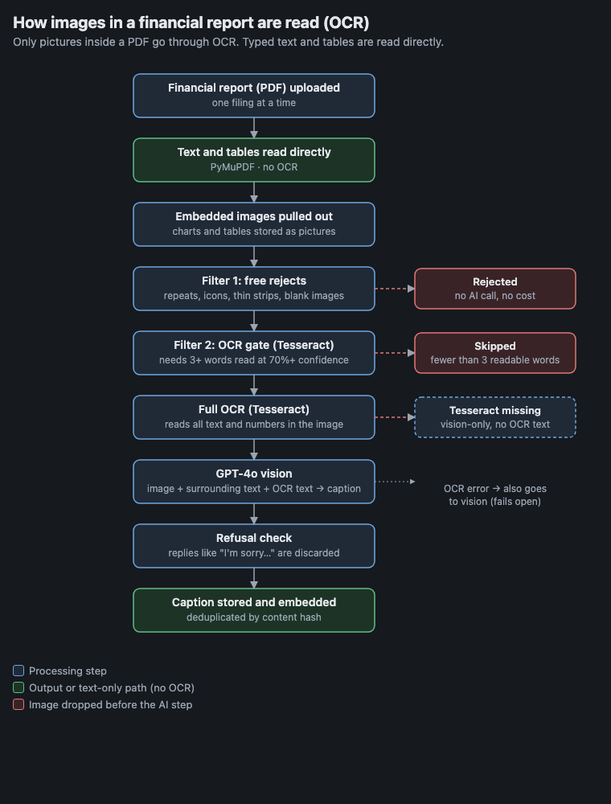

# Architecture

How the system (backend in `backend/`, web UI in `frontend/`) is put together, how a request flows through it, and where to make a change. Read [the README](../README.md) first for what the product does and how to run it.

**Contents:** [System at a glance](#1-system-at-a-glance) · [Code layout and rules](#2-code-layout-and-rules) · [Configuration](#3-configuration) · [A request, end to end](#4-a-request-end-to-end) · [Chat and background runs](#5-chat-and-background-runs) · [The RAG graph](#6-the-rag-graph) · [SEC filing ingestion](#7-sec-filing-ingestion) · [Your documents](#8-your-documents) · [The quant system](#9-the-quant-system) · [The web UI](#10-the-web-ui) · [Concurrency and scaling](#11-concurrency-and-scaling) · [Data model](#12-data-model) · [API reference](#13-api-reference) · [Extending the system](#14-extending-the-system) · [Known limitations](#15-known-limitations)

---

## 1. System at a glance



| Process | Started by | Does |
|---|---|---|
| **API** (`app/main.py`) | `uvicorn app.main:app` | HTTP routes, auth, file uploads, document reading, settings. Hands chats and long analyses to the workers and relays their live events to the browser. |
| **Interactive worker** (`app/worker.py`) | `python -m app.worker interactive` (Docker: `arq app.worker.InteractiveWorkerSettings`) | Streamed chats, queued asks/compares, quant queries. Up to `WORKER_INTERACTIVE_MAX_JOBS` at once. |
| **Batch worker** | `python -m app.worker batch` | Multi-ticker ALPHA runs, so they never delay a chat. |
| **MCP servers** (`quant/*_mcp`) | the API container's entrypoint, or `scripts/dev.py start` / `dev.py mcp` | Market-data tools the quant agents call: stock info 8565, technical 8566, research 8567, options 8568, Postgres 8570. |
| **PostgreSQL** | compose / managed | All application data, plus the LangGraph checkpointer shared by RAG and quant. |
| **Redis** | compose / managed | Arq job queues, live-update pub/sub, worker health keys. |
| **Qdrant** | compose / Qdrant Cloud | One hybrid collection per ticker (`ticker_<t>`), plus `user_documents` and `analyst_notes`. |

Each API and worker process builds its own copy of the RAG graph and the quant supervisor at startup (`app/core/agents_init.py`).

---

## 2. Code layout and rules

```
backend/
├── app/
│   ├── main.py            App factory, lifespan (startup/shutdown), router list, /health
│   ├── worker.py          Arq worker settings (interactive, batch)
│   ├── core/              config.py (all deployment settings), paths.py, logging_setup.py, middleware.py,
│   │                      concurrency.py, agents_init.py, security.py
│   ├── api/               One router per resource. Thin: validate, authorise, call a *_core or a service.
│   ├── services/          Business logic: app_settings (product settings), llm_providers, user_docs, chat,
│   │                      portfolio, report, connectors, data_sources, user_mcp, mcp_registry, ...
│   ├── jobs/              queue.py (Redis/Arq), rag_jobs.py, quant_jobs.py, chat_stream.py (worker chat relay)
│   ├── docproc/           Document-reading engine: OCR engines, layout, tables, figures, finance checks
│   ├── database/          models.py (SQLAlchemy), connection.py (async engine, sessions, migrations)
│   ├── auth/              JWT, password hashing, get_current_user, ownership checks, rate limits
│   └── utils/             Small shared helpers (company/fiscal mapping, filing types, progress, usage)
├── rag/                   LangGraph RAG pipeline: graph/, vectordb/, retrieval/ (re-rank), prompts/, utils/
├── quant/                 stock_agent/ (supervisor + sub-agents) and the five *_mcp servers
├── ingestion/             SEC filing PDFs, images, EDGAR fetcher, Form 4, macro data, batch ingest
├── alembic/               Migrations (single linear chain)
├── scripts/               Ingestion CLI, evaluations, developer tools
└── tests/                 pytest suite (see tests/README.md)

frontend/                  Web UI (React + Vite); see section 10 and frontend/README.md
```

**Rules that keep the codebase easy to change**

1. **Dependencies point down:** `api` → `services` / `jobs` → `rag` / `quant` / `ingestion` / `docproc` → `core` / `database` / `utils`. Nothing below `api` imports from `api`, except the job runners that reuse a route's `*_core` function.
2. **One implementation per action.** A route and its queued/streamed variant call the same `*_core` function (`ask_core`, `compare_core`, `alpha_core`, `query_core`). Never copy agent-invocation logic into a job.
3. **Configuration only through `app.core.config.get_settings()`.** No `os.getenv`, no `load_dotenv` in modules. Product behaviour users can change belongs in the settings schema (`app/services/app_settings/schema.py`), not in configuration.
4. **Paths only through `app.core.paths`.** Nothing depends on the current working directory.
5. **No blocking work on the event loop.** Network calls in `async` code are awaited or run with `asyncio.to_thread`; CPU-heavy work (OCR, BM25 embedding, PDF rendering) runs in a thread or a subprocess.
6. **Long work runs on a worker.** A request that can take more than a few seconds is streamed from a worker or queued as an `AnalysisTask`.
7. **Ownership on every resource route.** `Depends(get_current_user)`, then `verify_user_id_matches` (403) for a client-supplied `user_id` or `verify_owner` (404) for a fetched resource.
8. **Logging, not print.** `logging.getLogger(__name__)`; the format and level come from `app/core/logging_setup.py`.

---

## 3. Configuration

There are two kinds of settings.

| | Deployment settings | Product settings |
|---|---|---|
| **What** | Secrets, service URLs, pools, worker limits, document-engine switches, MCP server locations | Models per job, retrieval, answers, modules, prompts, documents, quant, appearance |
| **Declared in** | `backend/app/core/config.py` (`Settings`) | `backend/app/services/app_settings/schema.py` (`SECTIONS`) |
| **Set by** | Whoever runs the server | Users and admins in the Settings screen |
| **Read with** | `get_settings().<name>` | `app_settings.get(section, key)` inside a request, or the resolved dict |

### Where a deployment setting comes from (first match wins)

```
real environment variable  >  .env (repo root)  >  config.yaml (repo root, or APP_CONFIG_FILE)  >  default in config.py
```

Every field name is both its environment variable (upper case) and its `config.yaml` key. `config.example.yaml` lists all of them with defaults and descriptions; it is generated from `config.py`, and a test fails if it falls out of date. `get_settings()` is cached and rebuilt when the environment or the YAML file changes. In production (`APP_ENV=production`) startup fails if `JWT_SECRET_KEY`, `APP_SECRET_KEY`, `INTEGRATION_SECRET_KEY`, `MCP_SHARED_SECRET` or `OPENAI_API_KEY` is missing, or if CORS still allows any localhost origin.

```bash
cd backend
python -m app.core.config            # every setting, its value (secrets masked) and where it came from
python -m app.core.config --example  # regenerate config.example.yaml
```

### How product settings resolve (last wins)

```
code defaults (schema.py)
  → deployment defaults   config.yaml `settings_defaults:` · SETTINGS__<SECTION>__<KEY> env · MAX_UPLOAD_MB / MAX_PAGES
  → admin                 Settings screen, system scope
  → user                  Settings screen
  → portfolio             Settings screen, per portfolio
  → per request           a request's settings_override
```

Deployment defaults are validated against the schema at startup and shown in the Settings screen as each field's default. Model-provider keys follow their own order: a key the user saved in Settings → AI providers, then a key an admin saved, then the environment.

---

## 4. A request, end to end

1. **Middleware.** CORS (explicit origins; credentials allowed for the refresh-token cookie), then `RequestLoggingMiddleware` (pure ASGI so streamed responses are never buffered).
2. **Auth.** `get_current_user` decodes the JWT, loads the user, and rejects a token whose `ver` no longer matches `users.token_version` (logout and password change revoke every token).
3. **Database session.** `get_db_session` yields an `AsyncSession` (`expire_on_commit=False`). Routes commit explicitly. Before a long agent run, the request's transaction is committed so its pooled connection returns to the pool for the length of the run.
4. **Run context.** `app/services/run_context.py` loads the effective product settings and the user's provider credentials, checks the models needed are usable, and makes both current (context variables) for every node and tool in the run.
5. **Agent.** The route calls its `*_core` function, which invokes the compiled LangGraph graph with a checkpoint thread id prefixed `rag:` or `quant:` (the two systems share one checkpointer and can never collide).
6. **Usage.** Every model call reports tokens to a per-run tracker; totals are stored per role (`usage_events`) for the monthly budget.

---

## 5. Chat and background runs

There are three ways to run an analysis. All call the same `*_core` function.

| Path | Used for | How it runs |
|---|---|---|
| `POST /ask/stream`, `/quant/query/stream` | Chat with live progress (the default in the UI) | On the interactive worker when one is running, otherwise in the API process. Same events either way. |
| `POST /analysis-tasks/...` | Background runs, scheduled runs, multi-ticker ALPHA | Queued as an `AnalysisTask` on the interactive or batch queue. |
| `POST /ask`, `/compare`, `/alpha`, `/quant/query` | Direct calls (API clients, scripts) | In the API process; the request waits for the result. |

### Streamed chat on a worker (`app/jobs/chat_stream.py`)

```
browser ──POST /ask/stream──▶ API ──subscribe chat-stream:<id>──▶ Redis
                               API ──enqueue run_chat_stream──▶ interactive queue ──▶ worker
worker: ask_core(..., emit=publish) ──publish {"type":"step"|"token"|"done"|"error"}──▶ Redis ──▶ API ──SSE──▶ browser
```

- The API subscribes before enqueueing, so no event is missed, and forwards each message as one SSE frame. The browser sees exactly what the in-process path sends.
- Every 15 quiet seconds the relay sends an SSE comment (keepalive) and checks the job; a job that ended without a result produces an `error` event instead of a hang.
- A closed browser aborts the job (`allow_abort_jobs`), like the in-process path cancels its task.
- The job is never retried (a retry would save the user's message twice) and its result is not kept (it was streamed).
- `CHAT_STREAM_MODE=auto` (default) uses a worker when its Redis health key is fresh; `worker` and `inline` force one or the other.

### Queued runs (`app/api/analysis_tasks.py`, `app/jobs/rag_jobs.py`, `quant_jobs.py`)

Each enqueue creates an `analysis_tasks` row (`PENDING → RUNNING → COMPLETED | FAILED`), with step-by-step progress in `result_metadata.progress` and the full response in `result_metadata.response`. Every status change is written to the row and published on two Redis channels (per portfolio and per user), which back `GET /analysis-tasks/stream/{portfolio_id}` and `/stream/user/{user_id}`. Any enqueue accepts `scheduled_at` to defer the run.

| Route | Queue |
|---|---|
| `POST /analysis-tasks/rag/ask`, `/rag/compare`, `/quant/query` | interactive |
| `POST /analysis-tasks/rag/alpha` | batch |

---

## 6. The RAG graph

`rag/graph/builder.py` compiles the graph; nodes live in `rag/graph/nodes.py` and `extras.py`, routing in `edges.py`, state in `state.py`.

`route_query` picks a branch: **ALPHA** (`alpha_retrieve → alpha_generate`), **Scenario** (`scenario_retrieve → scenario_notes → scenario_generate`), **Macro** (`macro_analyze → macro_calculate → macro_format`), one of the user's **custom frameworks** (`custom_retrieve → custom_generate`), or **standard**:

```
clarify (optional pause) → preprocess → retrieve → grade_documents
        │                                     │            │
        │                                     │            ├─ enough evidence ─────────────→ generate
        │                                     │            └─ not enough → rewrite_query → retrieve (corrective retry)
        │                                     │                          └→ integrate_web_search → generate
        └─ web_search (when the question needs no filings) ───────────────────────────────────→ generate

generate → verify_answer → generate_chart (optional) → show_result
```

- **Preprocess** resolves tickers, filing types, fiscal quarters and years, and builds sub-queries. Comparison, segment and geographic questions use ready-made templates with no extra model call.
- **Retrieve** runs hybrid search (dense `text-embedding-3-large` + BM25, fused with RRF) per ticker, then a cross-encoder re-rank, and adds the user's notes and approved documents. A quarter or filing type you ask for gets its own search pass so a higher-scoring one cannot crowd it out; an exact fiscal-quarter filter falls back to an unfiltered search if it finds nothing.
- **Fiscal calendars.** `app/utils/company_mapping.py` maps each company's fiscal year-end month, so "Apple Q1" means October–December. A comparison across mismatched calendars carries a warning into the answer.
- **Verify** checks the figures and units in the answer against the retrieved evidence (`answers.verify_mode`: off, warn or strict).
- **Clarify** is a human-in-the-loop interrupt: the run pauses with a question and resumes with the user's answer (`clarification` on the next request).

---

## 7. SEC filing ingestion

`ingestion/edgar_fetcher.py` lists and fetches filings from EDGAR (HTML over HTTP, rendered to PDF locally with Playwright so the browser never calls sec.gov), and `ingestion/pdf_processor.py` ingests them. Entry points: `POST /edgar/ingest` (streamed progress) and `python scripts/ingest_ticker.py`.

| Field | Resolution order |
|---|---|
| `filing_type` | Explicit value, then the cover page, then the filename, then `10-K` as a last resort with a loud warning. |
| `period_end_date` | Explicit value (EDGAR's `reportDate`), then the cover page, otherwise left unset. |
| `fiscal_quarter` | Derived from the period end and the company's fiscal calendar, for 10-Qs only. |

1. **Text.** PyMuPDF reads each page. Financial tables are rebuilt from word positions, with a completeness guard that falls back to ruling-line extraction if any printed number would be dropped.
2. **Chunks.** 1,024 tokens with 300 overlap. Tables are packed whole into separate `[TABLES]` chunks. Each chunk is embedded with a context header (company, filing, period, section, page) when `CONTEXTUAL_PREFIX` is on; the stored text stays clean.
3. **Images.** Embedded charts are filtered, read with Tesseract, then captioned by a vision model:



4. **Duplicates.** Documents and images are deduplicated by content hash. Chunks are embedded and stored in small batches with retries.

**Form 4** (`ingestion/form4/`, `rag/utils/form4_insights/`): EDGAR Form 4 filings → common-stock transactions, deduplicated by accession, amendments replacing earlier rows → a role- and dollar-weighted advisory score that feeds ALPHA's Alignment dimension. **Macro** (`ingestion/ingest_macro_data.py`): FRED and BLS series written atomically to `data/macro/`, ingested at startup if missing and re-synced every 24 hours.

---

## 8. Your documents

```
upload or import → normalise → read → check → HOLD for approval → index → searchable
```

- **Normalise** (`services/user_docs/normalize.py`): images become a PDF; Excel/CSV, Word, PowerPoint, HTML and text are read natively.
- **Read** (`app/docproc`): digital pages by code; scans with local OCR (Tesseract by default; RapidOCR, PaddleOCR, docTR optional), escalating doubtful pages to a vision model according to the reading strategy (economy, balanced, accuracy).
- **Check**: finance arithmetic (totals, subtotals, units, currency) flags doubtful figures for a person to confirm.
- **Approve**: nothing is indexed until a person approves it (`documents.require_approval`); `documents.index_policy` decides what happens to low-confidence text.
- **Index** (`services/user_docs/store.py`): chunks go to the `user_documents` collection with owner and visibility, so search only returns what the user may read.

Reading runs as a background task in the API process (CPU work in threads and subprocesses) and survives restarts: `recover_interrupted` resumes documents left mid-read.

---

## 9. The quant system

`app/services/stock_agent.py` builds a LangGraph supervisor (`langgraph_supervisor`) over these agents; `app/services/quant_runtime.py` applies the user's settings (enabled agents, models, risk profile, step limit).

| Agent | Tools from |
|---|---|
| Ticker finder | web search |
| Stock information | MCP 8565 (`quant/yahoo_mcp`) |
| Technical analysis | MCP 8566 (`quant/technical_mcp`) |
| Research | MCP 8567 (`quant/research_mcp`) |
| Options intelligence | MCP 8568 (`quant/options_mcp`), deterministic analytics; see `docs/options_mcp/` |
| Postgres | MCP 8570 (`quant/postgres_mcp`), read-only queries on a database the user connected |
| Documents | the user's approved documents |
| Data Sources | the user's market-data providers (Alpha Vantage, Polygon, Finnhub, Twelve Data, FMP, custom API) |
| Your Tools | remote MCP servers the user connected; tools that change things need explicit permission |

`app/services/mcp_registry.py` is the single list of built-in MCP servers (URL, port, enabled, bind address; overridable per server in configuration). Agents that need an MCP server are only created when it answers at startup; `/quant/health` checks all enabled servers. Calls to the Postgres tool carry a signed, per-user token (`MCP_SHARED_SECRET`), so a model cannot point it at another user's database.

---

## 10. The web UI

`frontend/` is a React 19 + TypeScript app built with Vite. It talks to the API only over HTTP, so it can be served from anywhere (`npm run dev` on :5173 in development, its Docker image on :80 in production); `VITE_API_BASE_URL` (read at build time, in `services/http.ts` only) says where the API is.

```
frontend/src/
├── App.tsx          Routes; every page except /login sits behind ProtectedRoute
├── pages/           Route-level screens: Home (portfolio workspace), Repository, MyReports, DataSources, ...
├── features/        Self-contained areas with their own components and API calls: settings, userDocs, documents
│                    (filing library and inspector), notes, dataSources, library, chatScope
├── components/      layout/ (shell), ui/ (shared primitives), project/ (the research, quant and report tabs)
├── services/        One module per API resource; http.ts holds API_BASE, JSON requests and server-sent events
├── store/           Zustand stores (analysis runs, clipboard, report editor, providers, pending navigation)
└── context/         Providers (Auth, Theme, ChatCache) with their hooks in useAuth.ts, useTheme.ts, useChatCache.ts
```

| Concern | How it works |
|---|---|
| **Sign-in** | `useAuth()` holds the user and the access token in memory only; the refresh token is an httpOnly cookie the browser sends to `/auth/refresh`. `services/authInterceptor.ts` patches `fetch` once: on a 401 it refreshes silently and retries, and only signs the user out if that fails. |
| **API calls** | Each `services/*Api.ts` builds URLs from `API_BASE` and adds the bearer header (`authHeader.ts`). Response shapes are typed to match the backend's models. |
| **Live answers** | `streamPost()` in `http.ts` reads server-sent events over POST (EventSource cannot send a body or a bearer token): `/ask/stream` gives steps, tokens, then the full result. |
| **Background runs** | `analysisTasksApi` subscribes to `/analysis-tasks/stream/{portfolio}` and `/stream/user/{id}`; `store/analysisRunsStore` keeps the dashboard and notification bell in step with the workers. |
| **Settings** | The Settings screens are generated from `GET /settings/schema` (`features/settings/FieldControl.tsx`), so a field added to the backend schema appears with its label, help, limits and the deployment's default, with no UI change. |
| **Theme** | Colours, spacing and radii are CSS custom properties in `src/index.css` (light in `:root`, dark under `[data-theme="dark"]`); Tailwind reads the same variables. |

**Rules for UI code:** components get data through a `services/` module, never a raw `fetch` with a hand-built URL; a file under `context/` exports only its provider component (hooks live in `useX.ts`, so hot reload keeps state); Zustand selectors return stored values, never a freshly built array or object (that re-renders forever); use the CSS tokens rather than literal colours; `npm run lint` and `npm run build` must pass (CI runs both).

---

## 11. Concurrency and scaling

| Concern | Mechanism | Setting |
|---|---|---|
| Blocking agent steps and model calls | Each process's default thread pool is enlarged (Python's default is CPUs + 4) | `THREADPOOL_WORKERS` (64) |
| Database connections | Per-process pool; a request commits before a long run so its connection is free meanwhile | `DB_POOL_SIZE` (10) + `DB_MAX_OVERFLOW` (20); keep processes × 30 under Postgres `max_connections` (200 in compose) |
| Concurrent chats | Interactive worker job slots; add worker processes to scale | `WORKER_INTERACTIVE_MAX_JOBS` (30), `docker compose up --scale worker-interactive=N` |
| Long jobs | Per-queue time limit | `WORKER_INTERACTIVE_JOB_TIMEOUT` (1800 s), `WORKER_BATCH_JOB_TIMEOUT` (7200 s) |
| Market-data calls | Yahoo tools run in a thread pool inside the MCP server | `MCP_TOOL_THREADS` (32) |

The API process is a single process by design: heavy work runs on workers, and a few pieces of state (document-reading jobs, the login rate limiter) live in its memory. Scale chats with more interactive workers rather than more API processes. Above roughly 50 active users the limit is usually the model provider's rate limits, not this code.

---

## 12. Data model

| Table | Purpose |
|---|---|
| `users` | Accounts with a role (analyst, fund manager, admin) and a token version for real logout. |
| `portfolios`, `sessions` | Named ticker collections and their conversation sessions. |
| `chat_sessions`, `chat_messages`, `consolidated_summaries` | Conversation history for RAG and quant, with cached AI summaries. |
| `analyst_reports`, `report_draft_items` | Published and draft reports (Postgres full-text search) and the clipboard. |
| `analysis_tasks` | Status, progress and results of background runs. |
| `documents` | Cache of what is in Qdrant, behind the filing library. |
| `user_documents` | Uploaded files: status, approval, review state, extraction stats. |
| `analyst_notes`, `analyst_note_inclusions` | Notes, and who has switched shared notes into their analysis. |
| `app_settings`, `usage_events` | Layered product settings (system, user, portfolio) and per-call token and cost records. |
| `provider_credentials` | Model-provider keys saved in the app, encrypted. |
| `integrations`, `user_mcp_servers`, `user_data_sources` | Connected file/database sources, MCP servers and market-data providers, credentials encrypted. |
| `form4_transactions` | Insider transactions, indexed by issuer and date. |

LangGraph's checkpoint tables live in the same database. Migrations are one linear Alembic chain (head `025_user_data_sources`); the API and each worker run `alembic upgrade head` at startup, one process at a time (a Postgres advisory lock), so a fresh database is never migrated twice at once.

---

## 13. API reference

Interactive documentation is served at `/docs`. Every route needs a JWT except signup, login, refresh, `/`, `/health` (the app, its database and Redis), `/rag/health`, `/quant/health`, `/capabilities` and `/quant/capabilities`. Another user's resource returns 404, not 403.

| Area | Prefix | Main routes |
|---|---|---|
| Auth | `/auth` | `POST /signup`, `/login`, `/refresh`, `/logout` · `GET`/`PUT /me` |
| RAG | none | `POST /ask`, `/ask/stream`, `/compare`, `/alpha` · `GET /rag/health`, `/capabilities`, `/sessions/{id}`, `/portfolio/{id}/sessions` |
| Quant | `/quant` | `POST /query`, `/query/stream` · `GET /health`, `/capabilities`, `/sessions/{id}`, `/portfolio/{id}/sessions` |
| Background runs | `/analysis-tasks` | `POST /rag/ask`, `/rag/compare`, `/rag/alpha`, `/quant/query` · `GET /`, `/{task_id}`, `/stream/{portfolio_id}`, `/stream/user/{user_id}` |
| Portfolios | `/portfolios` | CRUD, `GET /user/{user_id}`, `/dashboard/cross-portfolio`, `POST`/`GET /sessions` |
| Chats | `/chats` | Sessions, messages, export, stats, summaries |
| Reports | `/reports` | Clipboard (`/draft/items`), `POST /from-draft/{user_id}`, CRUD, `/search`, `/repository/stats`, publish, `GET /{id}/export/pdf` |
| SEC filings | `/edgar` | `POST /ingest` (streamed), filing PDF download |
| Form 4 | `/form4` | `POST /ingest`, `/ingest/batch`, `/ingest/stream` |
| Filing library | `/documents` | List and facets, `POST /sync`, document, pages, `/pages/{n}/locate`, `/pdf`, `/ensure-pdf`, `/pdf-status` |
| Your documents | `/user-documents` | Upload, `/import`, list, `GET`/`PATCH`/`DELETE /{id}`, `/reread`, `/review`, `/approve`, `/content`, `/file`, `/pdf`, `/types` |
| Reading engines | `/reading` | `GET /engines`, `POST /engines/{id}/prepare`, `/engines/test` |
| Notes | `/notes` | `POST /transcribe`, CRUD, `PUT /{id}/inclusion` |
| Settings | `/settings` | User, portfolio and system layers, `/schema`, `/prompts`, `/usage`, `/frameworks/template` |
| AI providers | `/providers` | List, save, remove keys, `POST /{id}/test`, `GET /{id}/models` |
| Data sources | `/data-sources` | Market-data providers: list, add (tested first), update, remove, test |
| Your MCP servers | `/mcp-servers` | List, add (tested first), update, remove, test |
| File and database sources | `/integrations` | CRUD, `/disconnect`, `/test`, `POST /browse` |

---

## 14. Extending the system

**A Python library.** Add it with a version range to `dependencies` in `backend/pyproject.toml`, run `python scripts/dev.py lock` (re-pins only what changed) and `python scripts/dev.py install`, and commit `pyproject.toml`, `uv.lock` and `requirements.txt` together. Prefer libraries that ship wheels for Windows, macOS and Linux; run blocking ones off the event loop (rule 5).

**A deployment setting.** Add a typed field with a default and `description` to `Settings` in `app/core/config.py`, under the right `# ──` group. Read it with `get_settings().<name>` at the point of use (not at import time, if tests or reloads should see changes). Regenerate the example: `python -m app.core.config --example > ../config.example.yaml`. Add it to `.env.example` only if it is a secret or something everyone sets.

**A product setting (Settings screen).** Add a field to the right section of `SECTIONS` in `app/services/app_settings/schema.py` with `_f(type, default, label, help, ...)`. It is then validated, stored, layered, returned by `GET /settings/schema` and rendered by the UI. Read it with `app_settings.get(section, key)` inside a run.

**An API route.** Add it to the matching router in `app/api/` (or a new router added to `ROUTERS` in `app/main.py`). Depend on `get_current_user`, check ownership, keep logic in a service or `*_core` function, and test it in `tests/`.

**A long-running action.** Write the logic once as an `async def *_core(...)`, call it from the route, and add a job in `app/jobs/` that calls the same function (register it in `_FUNCTIONS` in `app/worker.py`). Pick the interactive queue for anything a user waits on, batch otherwise.

**A quant agent or MCP server.** Add the server under `quant/<name>_mcp/`, register it in `_DEFAULTS` in `app/services/mcp_registry.py` (and its `mcp_<name>_*` fields in config), start it in `backend/docker/entrypoint.sh` and add it to `MCP_SERVERS` in `scripts/dev.py` (and `scripts/start_mcp_servers.sh`), then create the agent in `app/services/stock_agent.py` and add it to `QUANT_AGENTS` in the settings schema. Run blocking library calls in a thread inside the server.

**A database change.** Edit `app/database/models.py`, then from `backend/`: `alembic revision -m "short_name"` with a revision id following the chain (`026_...`), write `upgrade`/`downgrade`, and run `alembic upgrade head`.

**A UI screen or API call.** Add the request to the matching `frontend/src/services/*Api.ts` (typed to the backend's response), build the screen under `features/<area>/` (or `pages/` for a new route, registered in `App.tsx` behind `ProtectedRoute`), keep shared state in a `store/` slice if more than one screen needs it, and run `npm run lint && npm run build` (or `python scripts/dev.py check`). A new product setting needs no UI work: add it to the backend schema.

**A test.** Backend: see [tests/README.md](../backend/tests/README.md). Before committing anything: `python scripts/dev.py check`.

---

## 15. Known limitations

- **Embeddings are shared.** Search uses the server's OpenAI key for everyone, whatever chat provider a user picks, and changing the embedding model means re-indexing every collection.
- **Poor scans.** Vision models can invent plausible text on very bad scans. Doubtful pages are held for review by default, and `scripts/extraction_eval.py` measures behaviour on financial statements.
- **Verification scope.** Answers are checked for figures and units against their sources, not for claims or reasoning.
- **Single API process.** Document reading and the login rate limiter keep state in the API process's memory, so run one API process and scale with workers (see [§11](#11-concurrency-and-scaling)).
- **Confirmation for changing tools.** Calls to a connected MCP tool that changes things rely on the agent asking first, because the quant stream has no interrupt step.
- **Bloomberg and Refinitiv** have no open internet API. Reach them through your own gateway with the Custom API data source.
- **Migration names.** Three early migrations share the name `add_chat_summary_fields`; they are a genuine linear sequence, not a branch.
